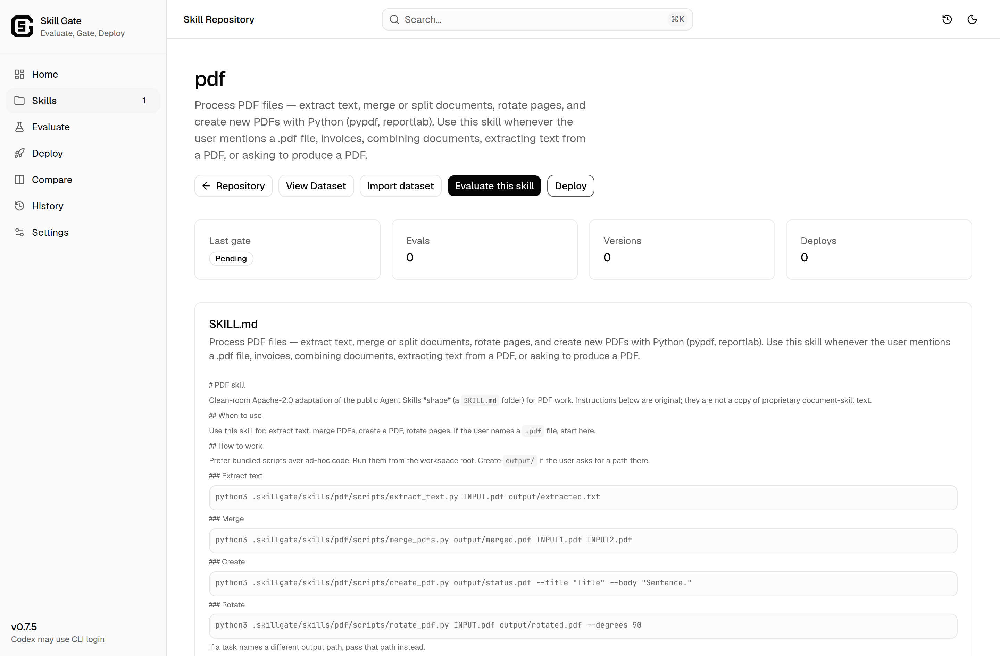

<p align="center">
  <picture>
    <source media="(prefers-color-scheme: dark)" srcset="web/public/sg-mark-dark.svg">
    
  </picture>
</p>

<h1 align="center">skillgate</h1>

<p align="center">A local gate for agent skills.</p>

<p align="center">
  <a href="https://pypi.org/project/skillgate-ai/"></a>
  <a href="https://pypi.org/project/skillgate-ai/"></a>
  <a href="https://github.com/vigneshm1995personal/skillgate/actions/workflows/gate.yml"></a>
  <a href="LICENSE"></a>
</p>

skillgate checks an agent skill that lives in a folder on your machine. A pack is `SKILL.md` plus `evals/`. `skillgate check` exits 0 when the run passes, 1 when it fails, and 2 when it cannot run. Live checks are scored only by a decision model you select. Requires Python 3.11+. The package name is `skillgate-ai` (`pip install skillgate` is a different project).

<p align="center">
  
</p>

## Quickstart

In an empty directory:

```bash
pip install skillgate-ai
skillgate example pdf
skillgate check skills/pdf
```

`skillgate example pdf` writes `skills/pdf`. The check exits 2 until an agent is available and a decision model is selected. Use `skillgate login` or `skillgate keys set` for the agent, and `skillgate judge provider set` for the decision model. These commands match release 0.7.5.

## Features

- One pack on disk, checked with `skillgate check`
- Exit 0 (pass), 1 (fail), or 2 (not ready)
- Live checks scored only by a decision model
- Custom scoring questions on top of the built-in questions
- `--expect-fail` for a pack that should fail
- Deploy copies skill files after a passing check
- Local UI with `skillgate ui`
- Compare two versions of the same dataset

## Usage

From the quickstart directory:

```bash
skillgate check skills/pdf
skillgate ingest skills/pdf
skillgate example pdf-sabotaged
skillgate check skills/pdf-sabotaged --expect-fail
skillgate deploy skills/pdf
skillgate judge provider show
skillgate judge add-question --ask "Did the answer follow the requested format?"
skillgate compare versions skills/pdf --dry-run
skillgate ui
```

`--expect-fail` exits 0 only when the live run is red. `skillgate deploy` copies the skill files after this pack already has a passing check. It does not run check for you. Deploy stays blocked until an agent is available, even after a green check. `skillgate ui` serves the local UI at http://127.0.0.1:8765. A version compare takes two `--run` ids or two `--git` refs.

Create a workspace and a skill:

```bash
skillgate init
skillgate new notes-helper
```

## Docker

```bash
docker compose run --rm --no-TTY skillgate
```

The image entrypoint is `skillgate`. The default command is `check /pack`. With nothing configured, that exits 2.

## Documentation

[Documentation](https://www.skill-gate-ai.app/docs)

## Contributing

Issues and pull requests are welcome.

## License

Apache License 2.0. See [LICENSE](LICENSE).
