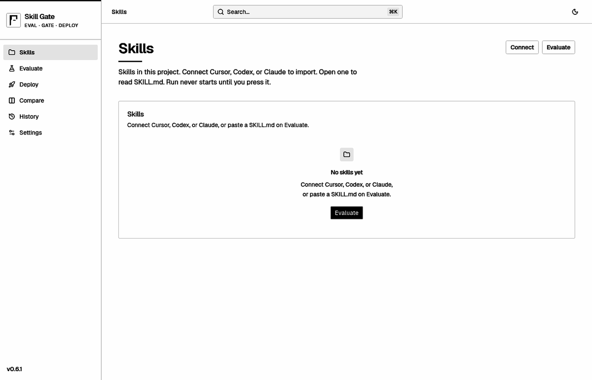

<p align="center">
  
</p>

<h1 align="center">Skill Gate AI</h1>

<p align="center">
  <strong>Local gate for <a href="https://agentskills.io">Agent Skills</a> — one pack on disk, live <code>skillgate check</code> (exit 0 / 1 / 2).</strong><br />
  No Skill Gate account. Bring your own model keys.
</p>

<p align="center">
  <a href="https://pypi.org/project/skillgate-ai/"></a>
  <a href="LICENSE"></a>
  <a href="https://github.com/vigneshm1995personal/skillgate/actions/workflows/gate.yml"></a>
  
</p>

<p align="center">
  <a href="https://www.skill-gate-ai.app/">Website</a> ·
  <a href="https://www.skill-gate-ai.app/docs">Docs</a> ·
  <a href="docs/quickstart.md">Quickstart (repo)</a>
</p>

<p align="center">
  
</p>

## Why Skill Gate

- **Catch regressions between versions** — compare history runs (or git refs) on the same Dataset (`skillgate compare versions`).
- **Pick the best model on cost vs quality** — run one Dataset across harness setups side by side (`skillgate compare models`).
- **Deploy to Cursor, Claude, or Codex after green** — `skillgate deploy` copies skill files only (not `evals/`) once checks pass and a model key is set.
- **Your own judge + custom checks** — optional scoring with your keys; add extra judge questions on top of the built-ins. See [`docs/judge.md`](docs/judge.md).

## Install

Requires **Python 3.11+**.

```bash
pip install skillgate-ai
```

(`pip install skillgate` is a different project.) CLI command: `skillgate`.

From a clone of this repo: `pip install -e ".[dev]"` (same CLI once the venv is on 3.11+).

## 10 minutes, no account

```bash
python3 -m venv .venv && source .venv/bin/activate   # Windows: .venv\Scripts\activate
pip install skillgate-ai
skillgate init
skillgate keys set OPENAI_API_KEY   # hidden prompt; or pipe stdin. Or paste in Settings (`skillgate ui`)
skillgate example sample-skill --dest skills/sample-skill
skillgate check skills/sample-skill
echo $?    # 0 when green, 2 when no key is configured
```

> **Note:** The packaged `sample-skill` example (commit-message writer) lands in the next PyPI release after 0.6.1. Until then, use `skillgate new my-skill` and add checks, or install from a repo clone that includes the example.

```bash
# optional: scaffold your own pack instead of the packaged example
skillgate new my-skill
skillgate check skills/my-skill
```

Optional local UI: `skillgate ui` → http://127.0.0.1:8765 ([`docs/ui.md`](docs/ui.md)). Run from your workspace root so `skills/` resolves.

- **Bring your own judge** — configure scoring in Settings or `skillgate judge` (your keys only; Skill Gate does not ship a scorer account). See [`docs/judge.md`](docs/judge.md).
- **Custom scoring questions** — add extras on top of Skill Gate’s six (`skillgate judge add-question`). Built-ins stay.

`--expect-fail` inverts the exit code (CI for a pack that should fail):

```bash
skillgate check skills/my-skill --expect-fail   # exit 0 only when the live run is red
```

`skillgate deploy` copies **only the skill files** (not `evals/`) into Cursor, Claude, or Codex **only if** this pack already has a passing check **and a model key is set**. It does not run check for you. Without a key, Deploy/Install stay blocked (CLI, API, and UI) even after a green check.

```bash
skillgate check skills/sample-skill
skillgate deploy skills/sample-skill
skillgate deploy skills/sample-skill --targets cursor,claude,codex
```

Create a workspace and a new skill (same as the UI):

```bash
skillgate init
skillgate new notes-helper
```

Full walkthrough: [`docs/quickstart.md`](docs/quickstart.md) and https://www.skill-gate-ai.app/docs.

## Docker (from this repo)

Image `ENTRYPOINT` is `skillgate`; default `CMD` is `check /pack` (never `serve`). Without a key, that exits 2.

Build and run locally (no registry required):

```bash
docker compose run --rm --no-TTY skillgate
```

To copy a packaged example inside the container (once `sample-skill` is in your install):

```bash
docker compose run --rm --no-TTY skillgate example sample-skill --dest /tmp/sample-skill
```

Mount your pack at `/pack` (read-only skips writing `evals/history/*.jsonl`). Compose in this repo mounts the pack read-write so history can append. Set `SKILLGATE_OPENAI_API_KEY` (or another documented `SKILLGATE_*` key name) in the container env — ambient `OPENAI_API_KEY` is ignored unless you pass `--key-env`.

## Copy-paste GitHub Action

Working directory is the skill pack. Exit 1 fails the job. No account. Needs Python 3.11+ **and** a key (Skill Gate does not read `OPENAI_API_KEY` unless you pass `--key-env`).

```yaml
- uses: actions/setup-python@v5
  with: { python-version: "3.12" }
- run: pip install skillgate-ai==0.6.1
- run: skillgate check . --key-env OPENAI_API_KEY
  env:
    OPENAI_API_KEY: ${{ secrets.OPENAI_API_KEY }}
```

Or set `SKILLGATE_OPENAI_API_KEY` in the job env instead of `--key-env`.

## Docs in this repo

| Doc | Topic |
| --- | --- |
| [`docs/quickstart.md`](docs/quickstart.md) | Keys, packaged example, live check |
| [`docs/pack.md`](docs/pack.md) | `evals/cases.yaml`, fixtures, goldens, history |
| [`docs/judge.md`](docs/judge.md) | Bring your own judge; custom scoring questions |
| [`docs/ui.md`](docs/ui.md) | Local UI (`skillgate ui`) |
| [`docs/plans/compare.md`](docs/plans/compare.md) | Compare models / versions |

Keys live in `{project}/.skillgate/keys` (gitignored, mode 0600). Ambient `OPENAI_API_KEY` / `AI_GATEWAY_API_KEY` / `AWS_*` are ignored unless you pass `--key-env`. **CI and Docker:** set `SKILLGATE_OPENAI_API_KEY` / `SKILLGATE_AI_GATEWAY_API_KEY` (and the other `SKILLGATE_*` key names). That prefix is the documented CI/Docker path and is always read. See `.env.example` for non-secret config.

## Layout

```
skills/<name>/SKILL.md
skills/<name>/evals/cases.yaml
src/skillgate_ai/     # this package
```

## Contributing

See [CONTRIBUTING.md](CONTRIBUTING.md). Bug reports and PRs welcome on GitHub.

## License

Apache-2.0 — see [LICENSE](LICENSE).
